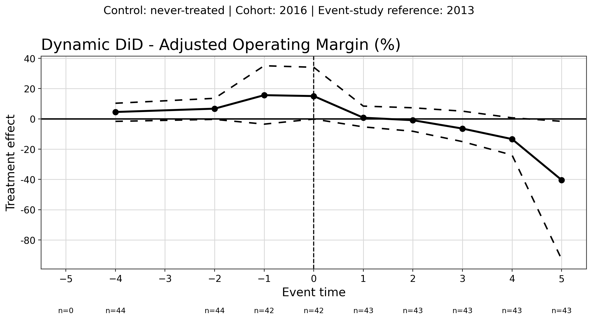
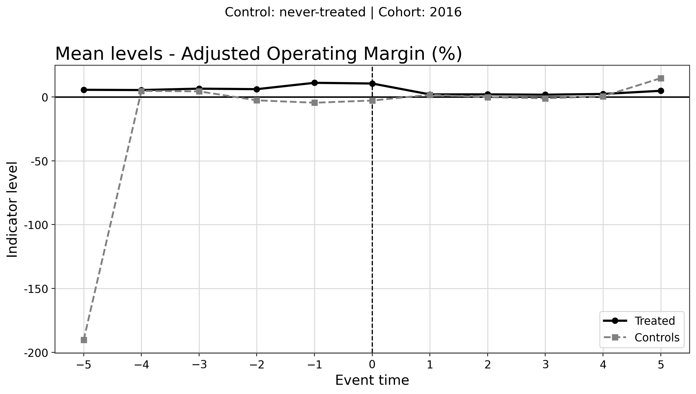
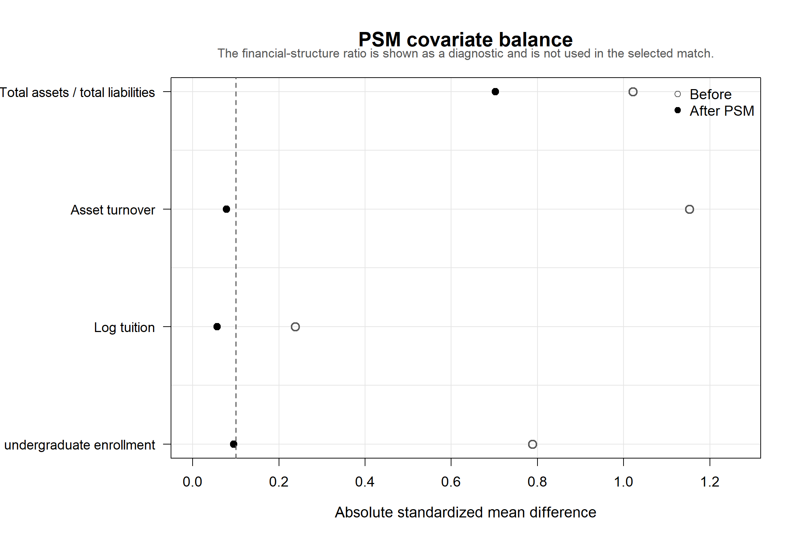
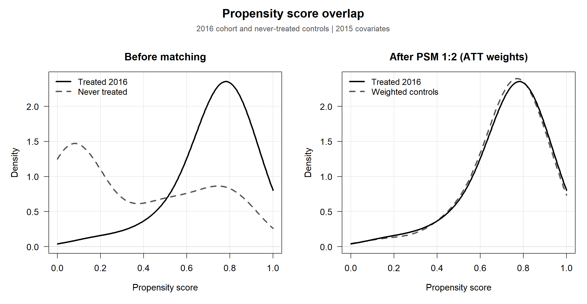
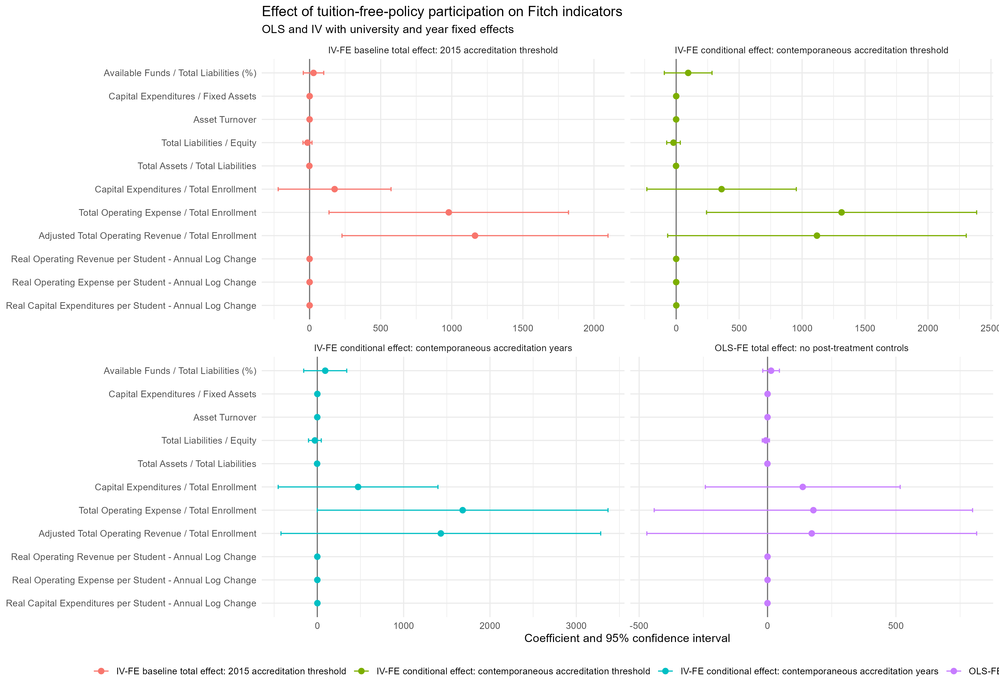
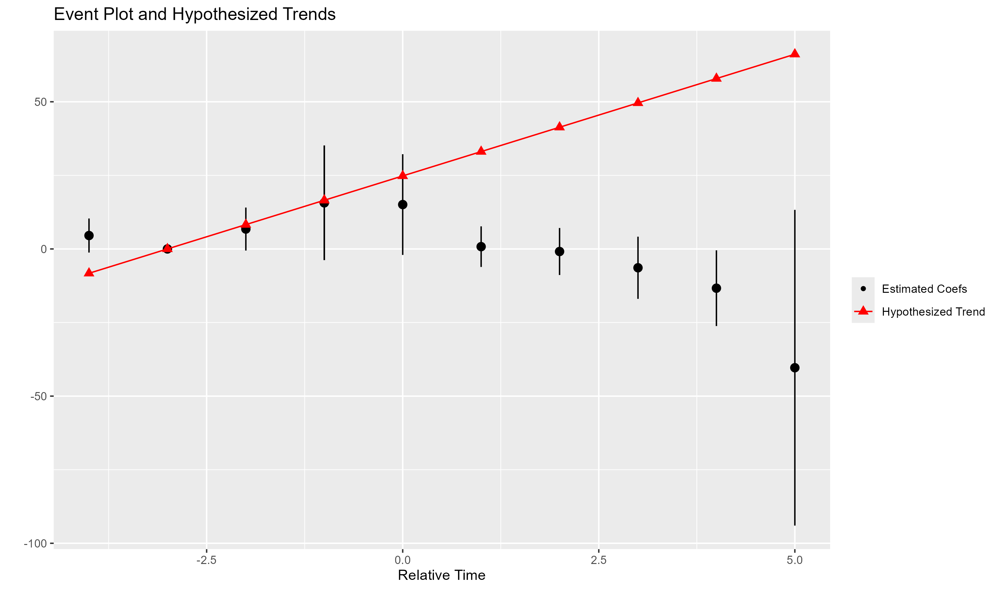

# Free College in Chile: university finances and institutional responses

Código y resultados seleccionados de un proyecto de investigación sobre los efectos de la política de gratuidad en la educación superior chilena. El repositorio reemplaza una versión preliminar y organiza los avances más recientes del panel financiero y de las estrategias empíricas.

## Pregunta de investigación

¿Cómo cambió el desempeño financiero de las universidades chilenas después de su incorporación a la política de gratuidad, en comparación con instituciones que nunca fueron tratadas durante la ventana analizada?

## Flujo analítico

1. **Construcción del panel:** armonización de estados financieros, matrícula, acreditación, elegibilidad e inflación.
2. **Indicadores Fitch:** ratios financieros, magnitudes reales por estudiante y cambios logarítmicos anuales.
3. **Difference-in-Differences:** cohorte tratada en 2016 frente a universidades nunca tratadas, con efectos fijos y controles.
4. **Synthetic DiD:** ponderaciones de unidades y períodos, bootstrap y pruebas de sensibilidad.
5. **Diseño PSM:** soporte común y balance pretratamiento.
6. **Variables instrumentales:** modelos IV-FE y diagnósticos de primera etapa.
7. **Pre-tendencias:** anticipación, potencia y sensibilidad con HonestDiD.

## Código

- [`Construcción de panel data/code`](Construcción%20de%20panel%20data/code)
- [`Difference-in-Difference Analysis/code`](Difference-in-Difference%20Analysis/code)
- [`Propensity Score Matching/Code`](Propensity%20Score%20Matching/Code)
- [`Instrumental Variables Analysis/code`](Instrumental%20Variables%20Analysis/code)
- [`Pre-Trends Analysis/code`](Pre-Trends%20Analysis/code)
- [Ecuaciones y especificaciones](docs/ECUACIONES_MODELOS_FREE_COLLEGE.tex)

## Avances seleccionados

### Difference-in-Differences





### Diseño y robustez



El ratio de estructura financiera se presenta como diagnóstico y no forma parte del emparejamiento seleccionado, tal como indica la figura.







Las tablas LaTeX seleccionadas se encuentran en [`Difference-in-Difference Analysis/results`](Difference-in-Difference%20Analysis/results).

## Reproducibilidad

Los datos no se publican. Consulta [`docs/data.md`](docs/data.md) para conocer los archivos esperados y las variables de entorno disponibles. Las dependencias se documentan en [`environment`](environment).

Ejemplo de ejecución desde la raíz del repositorio:

```powershell
python "Construcción de panel data/code/clean_panel.py"
python "Construcción de panel data/code/fitch_ind_def_v4.py"
python "Difference-in-Difference Analysis/code/DiD_FreeCollege.py"
Rscript "Difference-in-Difference Analysis/code/Synthetic_DiD_FreeCollege.R" --root=.
```

## Estado

Trabajo en desarrollo. Los resultados mostrados son avances de investigación y no deben interpretarse como conclusiones definitivas.

## Uso y atribución

No se adjunta una licencia de reutilización. Antes de reutilizar o redistribuir código o resultados, solicita autorización al autor y verifica los términos de las fuentes originales.
